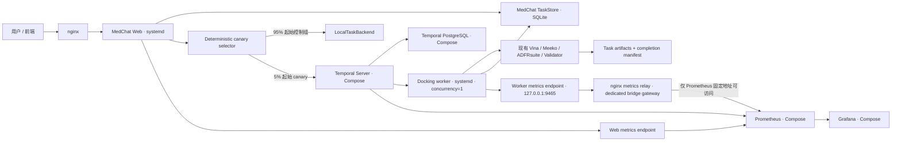

# MedChat Temporal 对接 Canary 生产就绪设计

**日期：** 2026-08-21
**状态：** 已确认，待实施计划
**前置阶段：** `docs/superpowers/specs/2026-08-12-industrial-agent-temporal-docking-canary-design.md`
**目标分支：** `codex/temporal-production-canary-readiness`
**修订：** 2026-08-22 增加宿主机 worker 指标安全中继，收敛 Prometheus 查询契约，并加固 systemd worker 生命周期

## 1. 背景与目标

阶段 3A 已建立可回滚的 Temporal 对接长任务 canary：统一任务门面可以在 local 与 Temporal 之间做确定性选择；Temporal Workflow、Activity 和独立 worker 能执行真实 Vina 对接；SQLite 投影、事件、artifact、哈希和 provenance 能追溯科学结果；Temporal 不可用时仅允许在 workflow 被接受前回落 local；真实 MAGL 样例重复三次通过。

当前缺口不再是“能否通过 Temporal 跑一次 docking”，而是“能否在单机 Linux 环境中安全运行、观测、逐级放量并快速回滚”。本阶段目标是把阶段 3A 的能力包装成可部署的生产候选，同时保持以下不变量：

1. 默认仍为 local、Temporal canary 0%；
2. 仅 docking 长任务进入 Temporal canary；
3. Web 与 worker 分进程运行，worker 并发固定为 1；
4. 科学判定继续由真实 Vina 产物、`ToolResult`、Validator 和 provenance 决定；
5. 放量只允许 0% → 5% → 10% → 25%，不得跳级；
6. 任意时刻允许将新流量回滚到 0%，已由 Temporal 接受的任务不得切回 local 重跑；
7. 生产发布必须由真实历史证据驱动，不能由 mock、LLM 自评或人工口头判断替代。

## 2. 范围

### 2.1 本阶段包含

- 单机 Linux 的 Temporal Server、Temporal UI、Temporal 内部 PostgreSQL、Prometheus、Grafana Docker Compose 部署资产；
- MedChat Web 与 Temporal docking worker 的 systemd 运行边界；
- worker Prometheus 指标导出和健康探针；
- 固定阶梯的 canary 配置管理、放量前检查、证据门禁和回滚；
- 真实 Temporal 任务观察报告、稳定性统计和脱敏；
- Temporal PostgreSQL 备份、恢复校验和故障处置 runbook；
- Compose、systemd、Prometheus、Grafana、配置管理、真实 Temporal 与真实 Vina 的测试；
- 项目规范和最新交接文档更新。

### 2.2 本阶段不包含

- 远程 Linux 主机实际部署、真实生产流量切换或 DNS/nginx 变更；
- Kubernetes、多主机 Temporal 集群、Temporal Cloud 或高可用 PostgreSQL；
- 把 MedChat TaskStore 从 SQLite 迁移到 PostgreSQL；
- 把 worker、Conda、RDKit、Vina、Meeko、ADFRsuite 或科学模型容器化；
- 将非 docking Agent workflow 迁移到 Temporal；
- 重写 Vina、配体/受体准备、评分或科学 Validator；
- 短信、邮件、微信、PagerDuty 等外部告警渠道；
- 自动执行生产放量；放量命令必须由有权限的运维人员显式触发；
- 定义组织级备份保留期限。生产备份保留策略由部署负责人在上线前确定，本阶段只提供可配置机制和恢复验证。

## 3. 方案选择

### 3.1 采用：混合式单机生产部署

基础设施通过 Docker Compose 运行：

- Temporal Server；
- Temporal UI；
- Temporal 专用 PostgreSQL；
- Prometheus；
- Grafana。

MedChat Web 和 docking worker 由宿主机 systemd 运行。worker 继续使用现有 Conda 环境和宿主机科学工具资产，避免重复封装 RDKit、Vina、Meeko、ADFRsuite、模型和结构缓存。

该方案把基础设施依赖与科学计算环境分离，能复用已验证的宿主机工具链，又能提供标准的 Temporal 持久化、监控和服务恢复能力。

### 3.2 不采用：全部容器化

全部容器化会在本阶段引入 GPU/CPU 指令集、Conda、外部二进制、模型权重、结构缓存和文件权限的额外变量，扩大科学结果回归面。容器化科学 worker 可作为后续独立阶段处理。

### 3.3 不采用：Temporal Cloud

Temporal Cloud 能减少服务端运维，但会增加外部网络、凭据和费用边界；当前目标是约 15 个在线用户的单机部署，不需要先引入托管控制面。

## 4. 总体架构



Temporal 负责调度、history、heartbeat、超时和取消；SQLite 继续作为 MedChat API 的任务查询投影；文件系统保存输入清单、pose 和 completion manifest。三者职责不得互相冒充：Temporal history 不是科学证据，SQLite 终态不是 artifact，LLM 文本不是 Vina 结果。

## 5. 部署资产

### 5.1 目录布局

实施阶段使用以下边界：

```text
deployment/
├── temporal/
│   ├── docker-compose.yml
│   ├── env.example
│   ├── prometheus/
│   │   ├── prometheus.yml
│   │   ├── rules/medchat-temporal.yml
│   │   └── tests/medchat-temporal.test.yml
│   └── grafana/
│       ├── provisioning/datasources/prometheus.yml
│       ├── provisioning/dashboards/dashboard.yml
│       └── dashboards/medchat-temporal-docking.json
├── medchat.service
├── medchat-temporal-worker.service
├── medchat-temporal-worker.tmpfiles
└── nginx-medchat-temporal-metrics.conf.template
scripts/
├── manage_temporal_canary.py
├── observe_temporal_canary.py
├── configure_temporal_metrics_relay.py
├── validate_temporal_worker_production.py
├── backup_temporal_postgres.py
└── restore_temporal_postgres.py
src/task_runtime/
└── production_worker.py
docs/runbooks/
└── temporal_docking_canary.md
```

文件名可在实施计划中按仓库现状做小幅调整，但职责不得合并成一个不可测试的部署脚本。

### 5.2 Docker Compose 边界

`deployment/temporal/docker-compose.yml` 必须满足：

- 使用固定大版本或不可变镜像标签，不使用 `latest`；
- PostgreSQL、Temporal gRPC、Temporal UI、Prometheus 和 Grafana 默认只绑定 `127.0.0.1`；
- Temporal 内部 PostgreSQL 使用独立数据库和账号，不复用 MedChat SQLite；
- 长期运行的 Temporal 使用固定版本 `temporalio/server`，不得使用已弃用的 `temporalio/auto-setup`；
- 使用匹配版本的 `temporalio/admin-tools` one-shot job 管理主库/visibility schema，并由独立 one-shot job 幂等创建或确认 namespace 后收敛 retention；
- schema 和 role-sync 在执行数据库客户端前验证 ASCII PostgreSQL identifier；exporter role-sync 不维护易漏的 catalog allowlist，而是直接 `DROP ROLE IF EXISTS temporal_exporter`，且禁止 `REASSIGN OWNED`/`DROP OWNED`，由 PostgreSQL 的集群级 dependency 检查对任何残留 ownership/ACL fail closed；成功后重建固定 `NOINHERIT` 登录角色，并仅授予 `pg_monitor` 的 `INHERIT TRUE`、`SET FALSE`、`ADMIN FALSE` membership；
- exporter 密码轮换只允许通过受测运维脚本重跑 role-sync 并 force-recreate exporter；脚本必须先检查 Compose 支持 `--wait`/`--wait-timeout`，再以 120 秒有界等待确认 `pg_up 1` healthcheck 通过后才返回成功；最低 Docker Compose 版本为 `>= 2.17`；
- exporter healthcheck 必须在有限超时内读取 metrics 并确认 `pg_up 1`，不能仅把 HTTP 200 视为健康；
- 密码、Grafana 管理凭据和其他 secret 只通过 Docker Compose file secret 注入；`env.example` 仅声明空的 `*_FILE` 路径键，不声明值型密码；
- PostgreSQL 使用 `POSTGRES_PASSWORD_FILE`，Grafana 使用 `GF_SECURITY_ADMIN_PASSWORD__FILE`；不原生支持 file secret 的镜像只允许在容器 entrypoint 内读取并导出，禁止写入 Compose service environment、命令参数或日志；
- 仓库只提交 `env.example`，不得包含真实凭据或机器绝对路径；secret 文件要求 regular file、非 symlink、无尾随换行、最多 1024 bytes；POSIX 主机上由 deployment owner 持有 `0700` 父目录，目录内 secret 文件固定为只读 `0444`，Windows 使用等效受限 ACL；本地 Compose `file:` secret 是 bind mount，service secret 的 `uid`、`gid`、`mode` 不会修复宿主文件权限；
- PostgreSQL、Temporal、Prometheus 和 Grafana 数据使用命名 volume；
- 依赖 Compose project 隔离网络名称，不设置全局 `name`；使用 internal `database`、Temporal API `temporal`、`temporal-metrics`、`postgres-metrics` 和 `prometheus-grafana` 最小网络，不使用默认全共享网络平面；
- 使用额外的专用 `worker-metrics-scrape` bridge 网络连接 Prometheus 与宿主机 nginx 指标中继；该网络使用部署时校验并生成的私有 CIDR、网关和 Prometheus 固定地址，只有 Prometheus 加入，其他 Compose 服务不得加入；
- 所有服务使用有上限的 `json-file` 日志轮换；长期运行服务配置 healthcheck 和 `unless-stopped`，one-shot job 使用有限 `on-failure:N` 并通过 `service_completed_successfully` 串联；
- Temporal schema 初始化采用官方支持的启动流程，不由 MedChat Web 执行；
- Compose 不挂载整个仓库，也不授予 Docker socket；
- 停止监控服务不得中断 Temporal workflow；停止 Temporal 服务不得导致 Web 在已接受任务上本地重跑。

### 5.3 systemd 边界

`medchat-temporal-worker.service` 必须：

- 使用与阶段 3A 真实验收相同的 MedChat Conda Python；
- 运行 `scripts/run_temporal_docking_worker.py`；
- 从权限受控的 `/etc/medchat/medchat.env` 读取非提交配置；
- 固定 `MEDCHAT_TEMPORAL_DOCKING_CONCURRENCY=1`；
- 设置独立工作目录、服务用户、明确的 restart policy 和启动超时；使用 `ProtectSystem=strict`、`UMask=0077`，只允许写入受控的 `scratch` 与 `temp_docking` 运行目录；
- 使用 `KillMode=mixed` 和 `TimeoutStopSec=90`：systemd 先只向 worker 主进程发送 SIGTERM，使 Temporal worker 停止 poll 并沿用阶段 3A 的受控 Vina 子进程清理；仅在超时后才由 systemd 强制清理同一 cgroup 的剩余进程；
- 不在命令行参数、状态输出或日志中暴露密码、API key、完整 prompt、SMILES 或绝对用户路径；
- 启动前执行严格生产配置校验，但不得在 `ExecStartPre` 运行 Vina、连接 Temporal、启动指标服务或修改 TaskStore；
- 与 Web 服务相互独立，worker 重启不能触发 Web 重启。

现有 `deployment/medchat.service` 仅在需要补充环境和依赖顺序时做最小修改，不改变 Web 的科学或 API 行为。

#### 5.3.1 生产配置门禁

生产 worker 使用共享、显式的校验器，例如 `src/task_runtime/production_worker.py`；`scripts/validate_temporal_worker_production.py` 只是其无副作用 CLI。校验器不得使用 Python `assert`，因此在 `PYTHONOPTIMIZE=1` 或 `python -O` 下仍必须 fail closed。它必须同时由 systemd `ExecStartPre` 和 `scripts/run_temporal_docking_worker.py` 调用，worker 入口必须在启动 metrics、连接 Temporal 或创建运行产物前完成复验，避免直接执行脚本绕过 systemd 门禁。

校验通过必须同时满足：

- backend 明确配置为 `temporal_canary`，docking concurrency 为 `1`；
- namespace 明确为 `default`，docking queue 明确为 `medchat-docking`；
- Temporal address、staging root、loopback worker metrics address 和 backup state path 均由生产环境显式配置，不得接受代码默认值冒充部署确认；
- TaskStore、staging、backup 和 docking 输出路径解析后均位于批准的可写根目录内，不得通过 `..`、符号链接或路径别名逃逸；
- 配置解析没有 warning；任何 fallback、local backend、空环境、非法端口或冲突路径均拒绝启动。

`/etc/medchat/medchat.env` 是必需部署资产，必须为 root:root 持有的 regular file、非符号链接、权限 `0600`。由于普通 `medchat` 服务用户不应直接读取该文件元数据或内容，service 使用一个范围最小的特权 `ExecStartPre=+... --check-environment-file /etc/medchat/medchat.env` 只验证 owner、mode、类型和 symlink 状态；该检查不得读取、打印或复制变量值。systemd manager 以 root 读取 `EnvironmentFile` 后，后续非特权 `ExecStartPre` 和 worker 仅验证已注入的配置值。

#### 5.3.2 运行目录引导与服务依赖

`deployment/medchat-temporal-worker.tmpfiles` 负责在 worker 启动前创建：

- `scratch`；
- `scratch/task_inputs`；
- `scratch/temporal_backups`；
- `temp_docking`。

这些目录固定由 `medchat:medchat` 持有并使用 `0700`。tmpfiles 配置只创建目录，不创建空的 `/etc/medchat/medchat.env`，也不改写未知已有文件。安装/runbook 必须先验证服务用户、仓库部署根目录、环境文件和目录权限，再启动 worker。

Docker/Compose 基础设施由运维流程管理并先于 worker 启动；worker unit 可以声明网络和 Docker 服务顺序依赖，但不得调用 Docker、自动执行 Compose 或修改基础设施状态。Temporal 不可达时 worker 应由受控 restart policy 重试，不能启动 local worker 代替。

## 6. 配置与密钥

### 6.1 配置来源

生产配置分为：

- Compose 基础设施配置：`/etc/medchat/temporal.env`，其中 secret 仅记录受保护 secret 文件的 `*_FILE` 路径，不记录 secret 值；
- MedChat Web/worker 配置：`/etc/medchat/medchat.env`；
- 仓库示例：不含 secret 的 `deployment/temporal/env.example`。

关键变量至少包括：

```text
MEDCHAT_TASK_BACKEND=temporal_canary
MEDCHAT_TEMPORAL_CANARY_PERCENT=0
MEDCHAT_TEMPORAL_ADDRESS=127.0.0.1:7233
MEDCHAT_TEMPORAL_NAMESPACE=default
MEDCHAT_TEMPORAL_DOCKING_QUEUE=medchat-docking
MEDCHAT_TEMPORAL_DOCKING_CONCURRENCY=1
MEDCHAT_TEMPORAL_WORKER_METRICS_ADDRESS=127.0.0.1
MEDCHAT_TEMPORAL_WORKER_METRICS_PORT=9465
MEDCHAT_TEMPORAL_METRICS_RELAY_SUBNET=172.30.95.0/28
MEDCHAT_TEMPORAL_METRICS_RELAY_GATEWAY=172.30.95.1
MEDCHAT_TEMPORAL_PROMETHEUS_SCRAPE_ADDRESS=172.30.95.2
MEDCHAT_TEMPORAL_METRICS_RELAY_PORT=9466
MEDCHAT_TEMPORAL_BASELINE_P95_SECONDS=40
```

基线 p95 必须为正数并通过部署前真实验收确定。默认示例值只用于配置结构说明，不能作为生产测量结论。指标中继的 CIDR、网关、Prometheus 地址和端口是一个不可分割的配置组；示例值仅为默认候选值。部署助手必须在生成配置前检查私有 IPv4、成员关系、地址互异、现有 Docker 网络和宿主机路由冲突，任何冲突都 fail closed。需要改网段时必须由同一次配置生成同时更新 Compose、Prometheus target 和 nginx listener，禁止手工只改其中一处。

### 6.2 安全规则

- 真实 API key、数据库密码和 Grafana 密码不得写入仓库、环境值、命令参数、报告或日志；对应 secret 文件由部署者创建并限制读取权限；
- 运行报告只允许记录 `credential_present: true/false`，不得记录掩码前后缀以外的密钥内容；
- 配置检查输出逻辑地址、namespace、queue 和端口，不输出数据库 DSN；
- artifact、SQLite 路径和工作目录对外只使用 repo-relative 或逻辑标识；
- 管理脚本拒绝符号链接配置文件和超出允许目录的目标路径；
- canary 配置文件必须由服务用户可读、仅授权运维角色可写。

## 7. Worker 指标与健康

### 7.1 指标导出

worker 使用 `prometheus-client` 暴露仅监听 loopback 的 HTTP 指标端点。依赖应作为部署可选依赖显式声明；缺失时 worker 必须拒绝生产模式启动，不得静默禁用监控。

指标 label 仅允许低基数固定集合，例如 `backend`、`task_type`、`status`、`error_code`。禁止使用 task ID、trace ID、workflow ID、用户 ID、文件路径、SMILES、prompt 或异常全文作为 label。

至少导出：

- worker process start time 和 readiness；
- last heartbeat timestamp / heartbeat age；
- 当前活动任务数；
- queue poll/readiness 状态；
- workflow start failures；
- docking process attempts；
- duplicate execution prevented；
- terminal event count；
- artifact validation result；
- task duration histogram；
- canary observation gate failures。

### 7.2 健康语义

worker readiness 为 true 需要同时满足：

- 配置合法；
- Temporal Server 和 namespace 可达；
- task queue 与配置一致；
- worker 已开始 poll；
- 指标端点正常；
- 并发配置为 1。

heartbeat age 超过 60 秒视为 stale。worker 没有活动任务时仍需通过进程级心跳证明服务存活；该心跳不得冒充某个 task Activity heartbeat。

### 7.3 宿主机指标中继

Prometheus 运行在 Compose 中，而 worker 为宿主机 systemd 进程。Docker 的 `host-gateway` 不能访问宿主机 `127.0.0.1`，因此不得把 `host.docker.internal:9465` 当作可用链路，也不得为了抓取方便把 worker 改为监听 `0.0.0.0`。

本阶段复用仓库现有的宿主机 nginx，增加独立的指标中继 server：

- worker 继续只监听 `127.0.0.1:9465`；
- nginx 只监听 `worker-metrics-scrape` 专用 bridge 的宿主机网关地址和中继端口，默认候选为 `172.30.95.1:9466`；
- 只允许 Prometheus 在该专用网络上的固定地址访问，其他来源 `deny all`；只开放精确的 `/metrics`，其他路径返回 404；
- nginx 将 `/metrics` 反向代理到 `http://127.0.0.1:9465/metrics`，使用短连接、有限 connect/read timeout，不转发客户端身份、认证头或任意路径；
- Compose 不发布中继端口，不把该端口绑定到公网或普通 LAN；只有 Prometheus 加入专用网络；
- 监控链路故障只能使 worker scrape 失败并阻止 canary 晋级，不得终止正在执行的科研任务，也不得把科学终态改写为失败。

`scripts/configure_temporal_metrics_relay.py` 是部署配置生成器，不是长期运行的代理。它从受控环境文件读取上述配置组，校验地址和冲突，并在 `/etc/medchat/generated/temporal-metrics/` 下生成 `compose.override.yml` 和 Prometheus `worker-targets.json`，同时生成 `/etc/nginx/conf.d/medchat-temporal-worker-metrics.conf`。所有写入使用临时文件、`fsync` 和原子替换。Compose 启动命令必须同时指定仓库主文件和生成的 override；主 Prometheus 配置通过 file-SD 读取生成 target，禁止复制三份静态地址。

首次部署顺序固定为：校验配置与路由冲突、生成运行时文件、用主 Compose 文件和 override 创建专用 bridge、确认网关地址已绑定、执行 `nginx -t` 并 reload、启动或重启 Prometheus、验证 worker target `up == 1`。后续改网段也遵循同一顺序。任一步失败都保留上一份有效配置且不 reload；若新 bridge 已创建但应用失败，部署助手必须报告人工回滚命令，不得静默删除未知网络。脚本输出只能包含逻辑配置和脱敏状态，不得输出 secret。

## 8. Prometheus、Grafana 与告警

### 8.1 Prometheus

Prometheus 抓取：

- MedChat Web 指标；
- Temporal docking worker 指标；
- Temporal Server 官方指标端点；
- Prometheus 自身。

scrape target 只使用本机或 Compose 内部网络地址。配置不得把 Grafana/Prometheus 暴露到公网。

worker target 必须通过第 7.3 节的 nginx 中继抓取。Prometheus 配置使用生成的 file-SD 文件，避免环境配置与静态 YAML 漂移；target 必须是专用 bridge 网关和中继端口。`up{job="medchat-temporal-worker"} == 1` 是 canary preflight 的硬条件。

### 8.2 告警规则

至少提供以下本地告警：

- worker heartbeat stale > 60 秒；
- 指定 namespace 与 docking task queue 的 backlog 持续增长；
- Temporal frontend 在指定 namespace 上的 `StartWorkflowExecution` unexpected service error；
- 单任务 Vina attempt > 1；
- 单任务 terminal event > 1；
- succeeded 任务 artifact validation 失败；
- Temporal 任务运行时 p95 超过 `min(1.5 × baseline, 60 秒)` 的反向条件，即任一阈值不满足便告警；
- canary infra/runtime failure rate > 5%；
- PostgreSQL 或 Temporal 不健康；
- 最近一次备份或恢复验证不健康。

阶段 3B 只配置 Prometheus rule 和 Grafana 可视化，不配置外部通知接收器。告警处于 firing 时必须阻止 canary 晋级。

规则必须满足以下查询契约：

- Temporal backlog 查询同时限定 `namespace` 和 docking `taskqueue`；Temporal start 查询同时限定 frontend `service_name`、`namespace` 与 `operation="StartWorkflowExecution"`；若固定版本导出的 label 名不同，实施时以真实 `/metrics` 样本为准更新规则和测试，不允许取消作用域；
- `service_requests` 只表示 start RPC 请求量，不表示 workflow 已被 Temporal 接受。dashboard 面板必须命名为“Workflow start requests”；真实 accepted 数继续由 observation report 的 history/TaskStore 证据提供；
- `service_errors` 只表示 unexpected service errors，告警名称和说明不得泛化为所有 start failure；需要细分错误时使用固定版本实际导出的 `service_error_with_type`，不得推断不存在的标签；
- p95 相对基线比较把基线规约为单一 scalar（例如 `scalar(max(medchat_temporal_baseline_p95_seconds))`），或显式统一标签后再比较，禁止无标签 histogram 与带 `job`/`instance` 的 gauge 做空向量匹配；
- 低频硬失败 counter 的 lookback 必须长于 `for` 窗口：start unexpected error 至少 `[15m]`/`for: 5m`，runtime failure rate 至少 `[30m]`/`for: 10m`；duplicate Vina、多终态、artifact/provenance 失败不设置 `for`；
- scrape/数据库不可用告警使用短但非零的 `for`，避免一次 scrape 抖动立即阻断；heartbeat 继续要求连续 stale；
- firing blocker 数量查询使用 `count(ALERTS{alertstate="firing",release_blocker="true"}) or vector(0)`，无告警时必须显示 0。

### 8.3 Grafana

提交可自动 provisioning 的 Prometheus datasource 和最小 dashboard，展示：

- local/Temporal 流量比例；
- queue backlog 和活动任务；
- Workflow start requests（不得标记为 accepted count）；
- worker heartbeat/readiness；
- 成功、partial、failed、canceled 分布；
- p50/p95 latency；
- Vina attempt、duplicate prevention、terminal invariant；
- artifact/provenance validation；
- 最近放量级别和观察窗口结果。

dashboard 不显示 prompt、SMILES、用户标识、文件路径或 secret。

## 9. Canary 状态机与配置管理

### 9.1 允许状态

唯一合法比例为：

```text
0 -> 5 -> 10 -> 25
```

规则：

- 晋级只能移动到下一个比例；
- 禁止 0→10、5→25 等跳级；
- 任意 5/10/25 均允许直接回滚到 0；
- 不支持自动回退到上一个非零比例；故障时统一停止新 Temporal 流量；
- 25% 是本阶段上限，100% 迁移需要新的设计评审；
- 管理器不直接重启 Web/worker，修改后由运维按 runbook reload/restart；
- 当前比例必须可以从脱敏状态接口和观察报告中确认。

### 9.2 配置管理器

`scripts/manage_temporal_canary.py` 提供只读状态、preflight、promote 和 rollback 命令。它必须：

- 使用文件锁防止两个运维进程并发修改；
- 读取严格解析的环境配置，只修改 canary percent 的唯一赋值；
- 拒绝重复键、非法行、符号链接、意外文件 owner/permission 和不受支持比例；
- 写入同目录临时文件，`fsync` 后原子替换；
- 保留权限和 owner；
- 失败时不留下半写文件；
- 输出变更前后比例、证据报告哈希和操作者提供的变更原因，不输出环境文件其他值；
- 不接受 `--force` 绕过证据门禁；紧急 rollback-to-0 不要求晋级证据，但仍需记录原因。

## 10. 发布流程与证据门禁

### 10.1 发布状态

```text
local / 0%
  -> preflight
  -> 5%
  -> observation gate
  -> 10%
  -> observation gate
  -> 25%
```

preflight 必须完成：

1. Temporal/PostgreSQL/worker/metrics 健康；
2. Temporal docking contract 验收重复 3 次；
3. 仓库 MAGL 样例真实 docking 重复 3 次；
4. 每次只有一次 Vina、一个终态，pose/能量/hash/provenance 均通过；
5. 当前不存在 firing 的阻断告警；
6. 备份命令成功且最近一次恢复验证记录有效。

### 10.2 观察窗口

每个非零级别晋级前必须满足以下二者之一：

- 当前级别累计至少 20 个由 Temporal 接受并进入终态的真实 docking 任务；或
- 完整观察 24 小时，且至少有 3 个由 Temporal 接受并进入终态的真实 docking 任务。

零 Temporal 任务不能用“观察满 24 小时”通过。mock、contract-only、replay、local backend 和手工伪造记录不计入真实任务数。

### 10.3 每个观察窗口的硬门槛

- 每任务 Vina attempt ≤ 1；
- 每任务恰好一个 terminal event；
- succeeded 任务 pose_count > 0；
- succeeded 任务 binding energy 为有限数值；
- pose 文件存在且 SHA-256 与 completion manifest、TaskStore provenance 一致；
- provenance 明确非 demo、非 fallback；
- worker heartbeat age ≤ 60 秒；
- Temporal Server、namespace、task queue 可达；
- 基础设施/运行时失败率 ≤ 5%；
- p95 latency ≤ `1.5 × 配置基线` 且 ≤ 60 秒；
- 报告不包含原始 payload、完整 prompt、SMILES、用户标识、绝对路径或 secret；
- 没有 firing 的阻断告警。

任意硬门槛失败时状态为 failed，禁止晋级并建议 rollback-to-0。证据不足时状态为 partial，仍禁止晋级。

## 11. 观察报告

`scripts/observe_temporal_canary.py` 从真实 TaskStore、task events、completion manifest 和 Temporal 查询投影生成结构化 JSON 报告。它不得调用 Vina、重启任务或修改终态。

报告至少包含：

- schema version、生成时间、时间窗、当前 canary level；
- 后端任务数、Temporal 已接受任务数、终态分布；
- pass/partial/fail rate；
- p50/p95 latency；
- error code 分布；
- worker/Temporal/queue health 摘要；
- duplicate execution、terminal invariant、artifact hash、provenance 检查；
- 每个 gate 的 `passed/failed/insufficient_evidence`；
- 总状态 `passed/partial/failed`；
- 输入数据源摘要与报告 SHA-256。

逐任务明细仅保留 task ID 和 workflow ID 的不可逆指纹、状态、耗时、attempt、错误码和 artifact 逻辑标识。报告不得包含数据库 DSN、环境变量值、绝对路径、用户数据或科学输入全文。

晋级管理器只接受 schema 合法、报告哈希匹配、时间窗结束后生成、当前 level 与配置一致且总状态为 passed 的报告。

## 12. 故障语义与回滚

### 12.1 Worker 异常

worker 崩溃后由 systemd 重启，Temporal 按阶段 3A 规则恢复 Activity。恢复前必须确认旧 Vina 进程所有权和 completion manifest；无法证明安全时任务失败，禁止重复执行 Vina。

### 12.2 Temporal 不可用

- workflow 尚未被 Temporal 接受：selector 可 fail closed 到 local，并记录原因；
- workflow 接受状态不明确：标记 ambiguous 并 reconcile，禁止 local 重跑；
- workflow 已被接受：继续由 Temporal 完成、失败或取消，禁止切换 backend。

Temporal 不可用会阻断晋级并建议 canary 回滚到 0%。

### 12.3 科学产物异常

pose 不存在、hash 不匹配、结合能无法解析、provenance 为 demo/fallback、重复 Vina 或多终态均为硬失败。系统不得把这些任务展示为真实成功，也不得让 LLM 补写缺失数值。

### 12.4 监控异常

Prometheus 或 Grafana 不可用不改变已完成任务的科学状态，但阻断 canary 晋级。Prometheus 告警与 observation report 冲突时按更严格结果处理。

### 12.5 回滚

回滚只把新任务比例改为 0%，不删除 Temporal history、TaskStore 记录、artifact 或 observation report。已接受任务继续在 Temporal 中收敛到终态。回滚后必须执行 reconciliation，并确认没有第二次 local Vina。

## 13. PostgreSQL 备份与恢复

Temporal PostgreSQL 必须使用官方 `pg_dump`/`pg_restore` 能力或等价的容器内命令生成逻辑备份。脚本必须：

- 从运行时环境读取凭据；
- 不把密码放入命令行或报告；
- 写入受控备份目录并生成 SHA-256；
- 记录数据库逻辑名、PostgreSQL major version、生成时间和校验状态；
- 拒绝覆盖未知已有文件；
- 失败时删除不完整临时文件；
- 支持 dry-run 和 restore verification。

恢复验证必须在隔离的临时数据库/容器中进行，不覆盖当前 Temporal 数据库。验证至少检查 schema 可读、关键 Temporal 表存在、dump hash 匹配和恢复命令成功。生产上线前由部署负责人明确备份目录、周期和保留期限。

## 14. 测试策略

实施遵循 TDD，分层验证如下。

### 14.1 单元测试

- 只允许 0/5/10/25；
- 晋级不得跳级，任意非零可回滚 0；
- evidence 不足、过期、level 不匹配、hash 不匹配或 gate 失败均拒绝晋级；
- 配置更新使用锁、原子替换并保留权限；
- 重复键、符号链接、非法 owner/permission 和意外路径被拒绝；
- 报告脱敏和低基数 label 约束；
- p50/p95、失败率、最小样本和 24 小时窗口计算；
- 监控不可用导致 promotion blocked，而不是篡改科学状态。
- 生产 worker 配置校验在空环境、local backend、默认值冒充显式配置、warning、路径逃逸和 `PYTHONOPTIMIZE=1` 下均 fail closed；
- 直接运行 worker 入口与 systemd `ExecStartPre` 使用同一校验器，且失败发生在 metrics、Temporal 连接和文件副作用之前；

### 14.2 静态部署测试

- `docker compose config` 验证 Compose；
- 镜像无 `latest`、端口 loopback、volume/healthcheck/restart policy 存在；
- systemd `systemd-analyze verify`，或在 Windows 上使用可重复的静态 parser 验证；
- Prometheus `promtool check config` 与 `promtool check rules`，工具缺失时如实标为未执行；
- Prometheus `promtool test rules` 使用提交的时序 fixture 验证 p95 基线匹配、namespace/task queue 作用域、低频 counter 窗口、availability grace period 和零 blocker 显示；
- Grafana provisioning 和 dashboard JSON schema 检查；
- 示例环境文件不含 secret 和绝对机器路径。

静态测试还必须验证 worker 仍只允许 loopback、Prometheus 不再引用 `host.docker.internal:9465`、只有 Prometheus 加入 `worker-metrics-scrape` 网络，以及 nginx 中继仅开放 `/metrics` 并带 allow/deny ACL。

systemd 部署测试还必须验证 `ProtectSystem=strict`、`UMask=0077`、`KillMode=mixed`、`TimeoutStopSec=90`、受限 `ReadWritePaths` 和两层 `ExecStartPre` 门禁；在 Linux 上使用 `systemd-analyze verify` 检查真实 unit。tmpfiles 测试必须证明四个运行目录可以从空部署状态创建为 `medchat:medchat`、`0700`，且不会创建或改写环境文件。环境文件元数据测试必须覆盖缺失文件、symlink、错误 owner、宽松 mode 和合法 root:root `0600`。

### 14.3 本地 Temporal 集成测试

- 启动本地 Temporal dev server 或 Compose；
- worker 连接、poll 和 metrics readiness；
- 在 opt-in Linux Docker 测试中创建专用 bridge、启动 loopback worker 指标端点、渲染并 reload nginx 中继，确认 Prometheus target `up == 1`；同时从非 Prometheus 容器和宿主机非中继地址验证访问被拒绝；Docker、nginx 或权限缺失时如实 skip，不能作为生产就绪证据；
- contract repeat 3；
- worker restart 后任务由 Temporal 恢复；
- 已接受任务不回落 local；
- 每任务 Vina attempt/terminal invariant 保持成立。

在 opt-in Linux systemd 集成测试中，使用可控的 worker/子进程 fixture 验证停止语义：SIGTERM 先到达 worker 主进程并触发协作式清理；正常清理窗口内不应同时终止 Vina 子进程；若 fixture 故意超时，systemd 最终必须清除同一 cgroup 内全部后代。测试结束后不得残留 worker 或科学工具进程。缺少 systemd/cgroup 权限时应明确 skip，不能以字符串断言替代该生产证据。

### 14.4 真实科学验收

- 使用 `data/samples/MAGL_5zun.pdb`、`data/samples/5.sdf` 和固定 box；
- 真实 Vina repeat 3；
- 每次必须有 pose、数值 binding energy、匹配 SHA-256、非 demo/fallback provenance；
- 不可用依赖必须 failed/partial，不得伪造 kcal/mol；
- 20 任务观察只在明确执行时运行，不以 mock 替代。

### 14.5 回归范围

- `tests/task_runtime/`；
- `tests/test_temporal_docking_routes.py`；
- docking、Agent 反幻觉和平台健康聚焦测试；
- `python -m compileall -q src scripts`；
- `scripts/run_agent_acceptance.py --mode contract`；
- Stage 3A Temporal docking acceptance。

## 15. 验收标准

本阶段完成需要同时满足：

1. Compose、systemd、Prometheus 和 Grafana 资产通过静态或本地工具验证；
2. worker 指标只监听 loopback，label 无高基数或敏感字段；Compose Prometheus 通过受 ACL 保护的 nginx 专用 bridge 中继真实抓取成功，且该中继不暴露到公网或普通 LAN；
3. canary manager 只允许 0/5/10/25、禁止跳级、支持安全 rollback-to-0；
4. promotion 只能消费真实、完整、未过期的 passed observation report；
5. observation report 能从真实任务历史计算样本、失败率、p50/p95 和所有科学不变量；
6. worker crash、Temporal 不可用、artifact 异常、监控异常和回滚行为均有测试；
7. 真实 MAGL/Vina repeat 3 继续通过，且每任务 Vina attempt ≤ 1、terminal event = 1；
8. 所有新增输出完成脱敏，没有 secret、用户数据、SMILES、完整 prompt 或绝对机器路径；
9. 默认配置仍为 canary 0%，没有自动切换真实生产流量；
10. production worker 在空环境、local backend、隐式默认、warning 或非法路径下拒绝启动，且 `python -O` 无法绕过；
11. worker 运行时文件系统为严格只读边界，新增文件默认私有，只有 tmpfiles 创建的四个 `medchat:medchat`、`0700` 目录可写；
12. systemd 停止先允许 worker 协作式清理，超时后清除整个 cgroup，测试后无 Vina 或 worker 后代残留；
13. runbook 能由部署人员完成环境文件校验、目录引导、Compose 先行启动、worker 启动、检查、晋级、回滚、备份和恢复验证。

## 16. 实施顺序

1. 先以测试定义 rollout state、observation schema、脱敏和配置写入边界；
2. 实现 canary manager 和 observation runner；
3. 扩展 worker 指标与健康；
4. 添加 Compose、Prometheus、Grafana 和 systemd 资产；
5. 添加备份/恢复脚本与 runbook；
6. 运行静态、单元、集成、真实 Vina 和回归测试；
7. 更新 `docs/PROJECT_STANDARDS.md` 与 `docs/handoff/latest.md`。

任何一步发现会改变科学工具算法、TaskStore 主存储或非 docking Agent workflow 时，应停止并创建独立设计，不在本阶段顺带实现。
